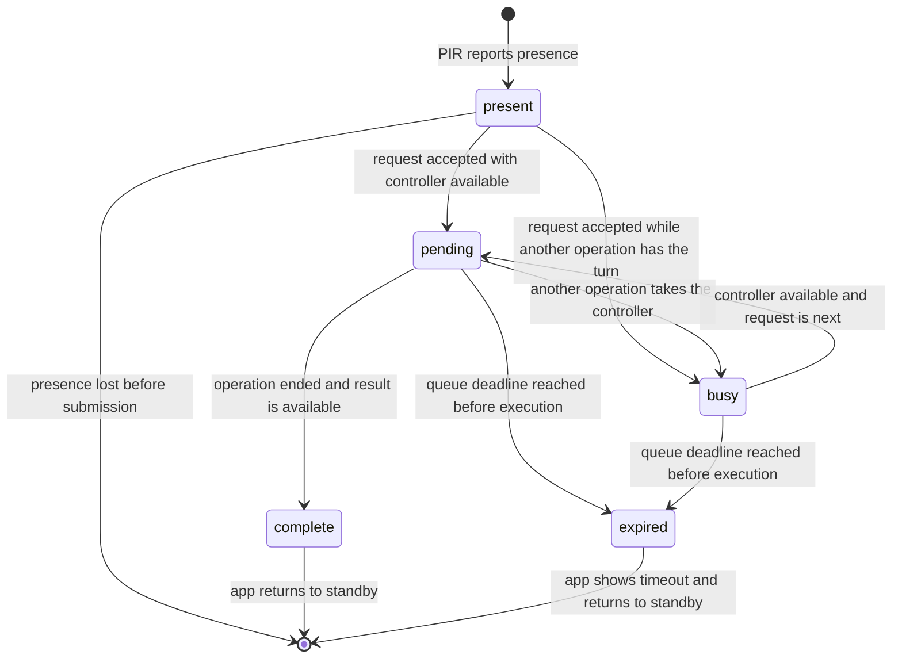

# Mobile API Contract
The Raspberry Pi exposes a local HTTPS service for the Android app. It reuses
the existing validation logic (access_logic.py) and authentication module
(autenticacion.py). The service is reachable only from the local network
(NFR-14).
## Security
All endpoints use HTTPS with TLS 1.2 or later. Protected operations use
Authorization: Bearer <token>. See [Mobile API security](mobile_security.md)
for certificate trust, session handling, and rate limits.
## OpenAPI contract

```yaml
openapi: 3.0.3
info:
  title: ControlAccesoLocal Mobile API
  version: "1.0"
  description: >
    Local HTTPS service for the Android app. The controller owns the hardware
    and processes access requests through its dispatcher.

servers:
  - url: https://raspberrypi.local:8000

components:
  securitySchemes:
    bearerAuth:
      type: http
      scheme: bearer

  schemas:
    LoginRequest:
      type: object
      required: [identificador, clave]
      properties:
        identificador:
          type: string
        clave:
          type: string
          format: password
          writeOnly: true
        biometric_public_key:
          type: string
          format: byte
          minLength: 1
          maxLength: 164
          description: Optional P-256 DER public key to link after a successful passcode sign-in.

    BiometricChallengeRequest:
      type: object
      required: [credential_id]
      properties:
        credential_id:
          type: string
          pattern: '^[A-Za-z0-9_-]{32}$'

    BiometricChallenge:
      type: object
      required: [challenge]
      properties:
        challenge:
          type: string
          pattern: '^[A-Za-z0-9_-]{32}$'
          description: Single-use ASCII value valid for 60 seconds.

    BiometricSessionRequest:
      type: object
      required: [challenge, signature]
      properties:
        challenge:
          type: string
          pattern: '^[A-Za-z0-9_-]{32}$'
        signature:
          type: string
          format: byte
          minLength: 1
          maxLength: 108
          description: DER ECDSA signature of the ASCII challenge using SHA-256.

    Session:
      type: object
      required: [token, expira]
      properties:
        token:
          type: string
        expira:
          type: string
          format: date-time
        biometric_credential_id:
          type: string
          pattern: '^[A-Za-z0-9_-]{32}$'
          description: Returned when this password sign-in links a device key.

    Presence:
      type: object
      required: [present]
      properties:
        present:
          type: boolean

    AccessRequestCreate:
      type: object
      required: [request_id]
      properties:
        request_id:
          type: string
          format: uuid
          description: >
            Client-generated idempotency key. The controller retains request IDs
            in memory for the lifetime of the process.

    AccessRequestStatus:
      type: object
      required: [request_id, state, result]
      properties:
        request_id:
          type: string
          format: uuid
        state:
          type: string
          enum: [pending, busy, complete, expired]
        result:
          type: string
          enum: [autorizado, sin_permiso, no_reconocido, error_sistema, null]
          nullable: true

    Error:
      type: object
      required: [error]
      properties:
        error:
          type: string

  responses:
    UnauthorizedSession:
      description: Session token is missing, invalid, or expired
      headers:
        WWW-Authenticate:
          schema:
            type: string
            example: Bearer
      content:
        application/json:
          schema:
            $ref: '#/components/schemas/Error'

    InvalidRequest:
      description: Invalid request data
      content:
        application/json:
          schema:
            $ref: '#/components/schemas/Error'

    TooManyRequests:
      description: The request limit has been reached
      headers:
        Retry-After:
          description: Seconds to wait before retrying
          schema:
            type: integer
            minimum: 1
      content:
        application/json:
          schema:
            $ref: '#/components/schemas/Error'

    AuthenticationUnavailable:
      description: Authentication service is unavailable
      content:
        application/json:
          schema:
            $ref: '#/components/schemas/Error'

paths:
  /sessions:
    post:
      summary: Log in and start a session
      requestBody:
        required: true
        content:
          application/json:
            schema:
              $ref: '#/components/schemas/LoginRequest'
      responses:
        '200':
          description: Session created, with the expiration timestamp in UTC
          content:
            application/json:
              schema:
                $ref: '#/components/schemas/Session'
        '401':
          description: Invalid credentials
          content:
            application/json:
              schema:
                $ref: '#/components/schemas/Error'
        '422':
          $ref: '#/components/responses/InvalidRequest'
        '429':
          $ref: '#/components/responses/TooManyRequests'
        '503':
          $ref: '#/components/responses/AuthenticationUnavailable'
    delete:
      summary: Log out
      security:
        - bearerAuth: []
      responses:
        '204':
          description: Session closed or already absent
        '401':
          description: A Bearer token is required
          headers:
            WWW-Authenticate:
              schema:
                type: string
                example: Bearer
          content:
            application/json:
              schema:
                $ref: '#/components/schemas/Error'
        '503':
          $ref: '#/components/responses/AuthenticationUnavailable'

  /sessions/biometric/challenge:
    post:
      summary: Request a biometrics-protected sign-in challenge
      requestBody:
        required: true
        content:
          application/json:
            schema:
              $ref: '#/components/schemas/BiometricChallengeRequest'
      responses:
        '200':
          description: Challenge bound to this credential and source IP
          content:
            application/json:
              schema:
                $ref: '#/components/schemas/BiometricChallenge'
        '422':
          $ref: '#/components/responses/InvalidRequest'
        '429':
          $ref: '#/components/responses/TooManyRequests'
        '503':
          $ref: '#/components/responses/AuthenticationUnavailable'

  /sessions/biometric:
    post:
      summary: Verify the signature and start a session for the linked user
      requestBody:
        required: true
        content:
          application/json:
            schema:
              $ref: '#/components/schemas/BiometricSessionRequest'
      responses:
        '200':
          description: Session created, with the expiration timestamp in UTC
          content:
            application/json:
              schema:
                $ref: '#/components/schemas/Session'
        '401':
          description: Invalid challenge, invalid signature, or inactive account
          content:
            application/json:
              schema:
                $ref: '#/components/schemas/Error'
        '422':
          $ref: '#/components/responses/InvalidRequest'
        '503':
          $ref: '#/components/responses/AuthenticationUnavailable'

  /presence:
    get:
      summary: Current PIR presence state
      security:
        - bearerAuth: []
      responses:
        '200':
          description: PIR presence state
          content:
            application/json:
              schema:
                $ref: '#/components/schemas/Presence'
        '401':
          $ref: '#/components/responses/UnauthorizedSession'
        '429':
          $ref: '#/components/responses/TooManyRequests'
        '503':
          description: PIR presence state or authentication service is unavailable
          content:
            application/json:
              schema:
                $ref: '#/components/schemas/Error'

  /access-requests:
    post:
      summary: Submit an access request
      security:
        - bearerAuth: []
      requestBody:
        required: true
        content:
          application/json:
            schema:
              $ref: '#/components/schemas/AccessRequestCreate'
      responses:
        '202':
          description: Request accepted in pending or busy
          content:
            application/json:
              schema:
                $ref: '#/components/schemas/AccessRequestStatus'
        '401':
          $ref: '#/components/responses/UnauthorizedSession'
        '403':
          description: PIR presence is absent or the UUID belongs to a different session
          content:
            application/json:
              schema:
                $ref: '#/components/schemas/Error'
        '409':
          description: UUID already submitted by this session, with the existing status
          content:
            application/json:
              schema:
                $ref: '#/components/schemas/AccessRequestStatus'
        '422':
          $ref: '#/components/responses/InvalidRequest'
        '429':
          $ref: '#/components/responses/TooManyRequests'
        '503':
          description: Controller, PIR presence state, or authentication service is unavailable
          content:
            application/json:
              schema:
                $ref: '#/components/schemas/Error'

  /access-requests/{request_id}:
    get:
      summary: Poll the state and result of an access request
      security:
        - bearerAuth: []
      parameters:
        - name: request_id
          in: path
          required: true
          schema:
            type: string
            format: uuid
      responses:
        '200':
          description: Current state, with the result once complete
          content:
            application/json:
              schema:
                $ref: '#/components/schemas/AccessRequestStatus'
        '401':
          $ref: '#/components/responses/UnauthorizedSession'
        '403':
          description: The UUID belongs to a different session
          content:
            application/json:
              schema:
                $ref: '#/components/schemas/Error'
        '404':
          description: Request UUID not found
          content:
            application/json:
              schema:
                $ref: '#/components/schemas/Error'
        '422':
          $ref: '#/components/responses/InvalidRequest'
        '429':
          $ref: '#/components/responses/TooManyRequests'
        '503':
          description: Controller or authentication service is unavailable
          content:
            application/json:
              schema:
                $ref: '#/components/schemas/Error'
```

## State machine

- present is the app state after GET /presence reports presence, before
  the app submits a request.
- pending means the request is next in the queue or is already running.
- busy means another operation has the turn or another request is ahead
  in the queue.
- complete means the operation ended and its result is available.
- expired means the queue deadline passed before execution started.
A new request requires active PIR presence. When presence is active, the
controller can accept and queue a request while another operation has the
turn. The controller processes one operation at a time and checks presence
again before taking the next request.

If the owning session repeats a UUID, POST /access-requests returns 409
with the current status and keeps the original queue entry. The owning
session can poll the request until it reaches complete or expired. Use
the same UUID when retrying a submission. The dispatcher retains request
IDs and results in memory for the lifetime of the controller process.


## Timing

- Session lifetime is 10 minutes (DURACION_SESION_MINUTOS in
  autenticacion.py).
- Queue timeout is 10 seconds from acceptance. Once the controller takes
  a request, the request keeps its turn until the operation ends and the
  controller returns to standby.
- Network response time has a target of under 2 seconds per HTTP round
  trip, per NFR-14.

## Running the mobile API on the Raspberry Pi

From the repository root, use the Python environment that already runs
the Raspberry Pi controller.

```bash
python3 -m pip install -r requirements-mobile-api.txt
```

Set `API_HOST` to the Raspberry Pi's LAN IP address. Set `API_CERT` and
`API_KEY` to the server certificate and private key paths. Keep the private
key outside the repository.

```bash
python3 src/Main_code.py --solo-botones \
  --api-host "$API_HOST" \
  --api-cert "$API_CERT" \
  --api-key "$API_KEY"

```

Omit `--solo-botones` to use the graphical controller. In either mode, the API
listens on HTTPS port 8000 and shares the active controller's dispatcher.
Android connects to https://raspberrypi.local:8000/ using the certificate
trust configuration described in [Mobile API security](mobile_security.md).

## Endpoint responses

| Endpoint | Success | Other responses |
| --- | --- | --- |
| `POST /sessions` | `200` with token and expiration, plus credential ID when linking | `401`, `422`, `429`, `503` |
| `DELETE /sessions` | `204` with no body, including on repeat requests | `401`, `503` |
| `POST /sessions/biometric/challenge` | `200` with a one-use challenge | `422`, `429`, `503` |
| `POST /sessions/biometric` | `200` with token and expiration | `401`, `422`, `503` |
| `GET /presence` | `200` with presence status | `401`, `429`, `503` |
| `POST /access-requests` | `202` with queued request status | `401`, `403`, `409`, `422`, `429`, `503` |
| `GET /access-requests/{request_id}` | `200` with request state and result | `401`, `403`, `404`, `422`, `429`, `503` |

Rate-limited responses include `Retry-After` in seconds.

## Verification

Automated tests cover password-based linking, signature verification,
challenge reuse, and inactive accounts. Password sign-in was confirmed on the
Moto e13. Biometric sign-in still needs an end-to-end test on a handset that
exposes Class 3 biometrics to the app.

## Android biometric sign-in (LAC-123)

The sign-in screen offers an option to link this phone during a successful
identifier and passcode sign-in. Android generates a P-256 key in Android
Keystore and requires a strong biometric whenever the app uses the private
key to sign. The Raspberry Pi stores the corresponding public key and its
account association. The Android system chooses the biometric modality
available on the phone.

| Endpoint | Request | Successful response |
| --- | --- | --- |
| `POST /sessions` | Existing sign-in fields plus optional `biometric_public_key`, a base64 DER SubjectPublicKeyInfo for a P-256 key | Standard session, plus `biometric_credential_id` when a key was linked |
| `POST /sessions/biometric/challenge` | `credential_id` returned at enrollment | `challenge`, valid for 60 seconds and usable once |
| `POST /sessions/biometric` | `challenge` and `signature`, the base64 DER ECDSA signature over the ASCII challenge using SHA-256 | Standard session with `token` and `expira` |

The server limits challenge issuance to five per IP per minute and binds each
challenge to the credential and the originating IP. A missing or revoked
credential, invalid signature or inactive user fails authentication. Successful
biometric and password sign-ins use the same access request flow and authorization
checks. The server verifies possession of the linked key. Attestation of the
client key's hardware origin is outside this implementation.

### Set up the Raspberry Pi

With the application stopped, apply the migration once using a MySQL
administrator, then update the existing Python environment.

```bash
mysql -u root -p < src/scripts_db/add_mobile_biometrics.sql
"$HOME/ControlAccesoLocal-repo/.venv-rpi/bin/python" -m pip install -r requirements-mobile-api.txt
```

Restart the HTTPS service with its usual command. In the Android app, enroll a
strong biometric in Android settings if the phone supports one. On the first
sign-in, select **Activar biometría en este teléfono** and enter the project
identifier and passcode. Return to identification and choose **Ingresar con
biometría** to verify the linked credential. Phones with no strong biometric
available can sign in with ID and passcode.

To revoke a lost phone's credential, delete its row in
`credenciales_biometricas_movil` using a MySQL administrator account. Linking a
replacement phone requires another password sign-in.
