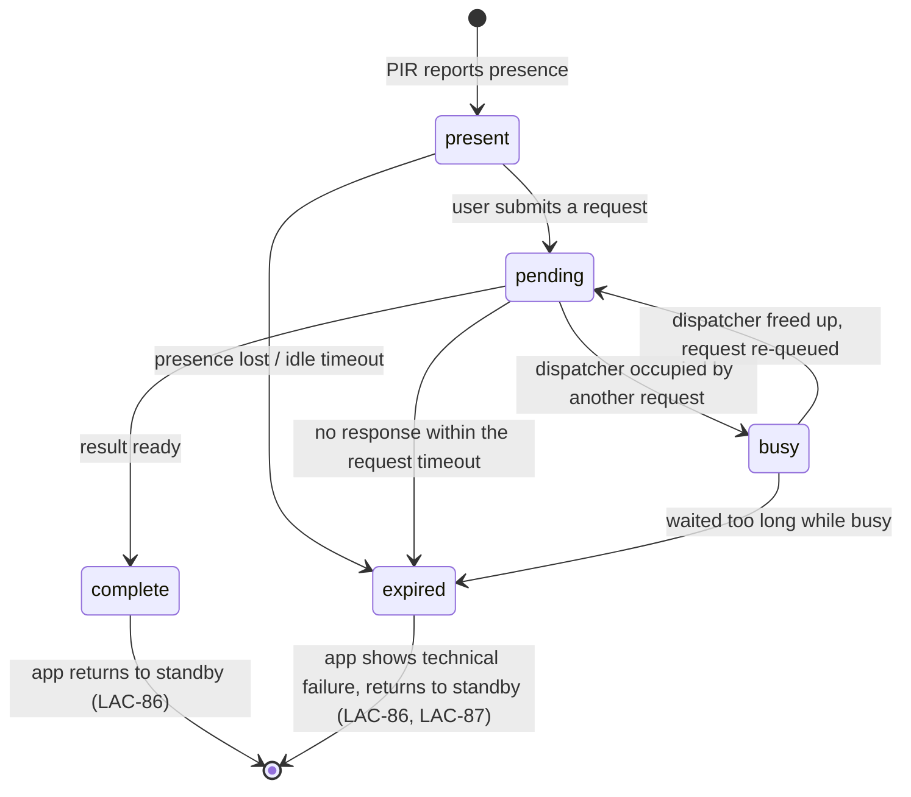

# Mobile API Contract

Local HTTP service exposed by the Raspberry Pi to the Android app. It reuses
the existing validation logic (`access_logic.py`) and authentication module
(`autenticacion.py`) — it does not implement its own authorization rules.
Not exposed outside the local network (NFR-14).

## Security

All endpoints MUST be served over HTTPS (TLS 1.2+). Plaintext HTTP is not
permitted.

## OpenAPI contract

```yaml
openapi: 3.0.3
info:
  title: ControlAccesoLocal Mobile API
  version: "1.0"
  description: >
    Local HTTP service exposed by the Raspberry Pi. Reuses the existing
    access_logic.py and autenticacion.py — it implements no authorization
    rules of its own. Not reachable outside the local network (NFR-14).
    All communication MUST occur over HTTPS.

servers:
  - url: https://raspberrypi.local:8000

components:
  securitySchemes:
    bearerAuth:
      type: http
      scheme: bearer

  schemas:
    LoginRequest:
      type: object
      required: [identificador, clave]
      properties:
        identificador:
          type: string
        clave:
          type: string

    Session:
      type: object
      properties:
        token:
          type: string
        expira:
          type: string
          format: date-time

    Presence:
      type: object
      properties:
        present:
          type: boolean

    AccessRequestCreate:
      type: object
      required: [request_id]
      properties:
        request_id:
          type: string
          format: uuid
          description: >
            Client-generated idempotency key. Resubmitting an existing
            request_id MUST NOT trigger a new physical access attempt.

    AccessRequestStatus:
      type: object
      properties:
        request_id:
          type: string
          format: uuid
        state:
          type: string
          enum: [present, pending, busy, complete, expired]
        result:
          type: string
          enum: [autorizado, sin_permiso, no_reconocido, error_sistema]
          nullable: true

    Error:
      type: object
      properties:
        error:
          type: string

paths:
  /sessions:
    post:
      summary: Log in and start a session
      requestBody:
        required: true
        content:
          application/json:
            schema:
              $ref: '#/components/schemas/LoginRequest'
      responses:
        '200':
          description: Session created
          content:
            application/json:
              schema:
                $ref: '#/components/schemas/Session'
        '401':
          description: Invalid credentials (same response for every failure case)
          content:
            application/json:
              schema:
                $ref: '#/components/schemas/Error'
    delete:
      summary: Log out
      security:
        - bearerAuth: []
      responses:
        '204':
          description: Session closed (always, even if it did not exist)

  /presence:
    get:
      summary: Current PIR presence state
      security:
        - bearerAuth: []
      responses:
        '200':
          description: Presence state
          content:
            application/json:
              schema:
                $ref: '#/components/schemas/Presence'
        '401':
          description: Session token is missing, invalid, or expired
          content:
            application/json:
              schema:
                $ref: '#/components/schemas/Error'
        '503':
          description: PIR sensor inactive or unreachable
          content:
            application/json:
              schema:
                $ref: '#/components/schemas/Error'

  /access-requests:
    post:
      summary: Submit an access request
      security:
        - bearerAuth: []
      requestBody:
        required: true
        content:
          application/json:
            schema:
              $ref: '#/components/schemas/AccessRequestCreate'
      responses:
        '202':
          description: Request accepted, now pending
          content:
            application/json:
              schema:
                $ref: '#/components/schemas/AccessRequestStatus'
        '401':
          description: Session token is missing, invalid, or expired
          content:
            application/json:
              schema:
                $ref: '#/components/schemas/Error'
        '409':
          description: request_id already exists; returns the existing request instead of creating a new one
          content:
            application/json:
              schema:
                $ref: '#/components/schemas/AccessRequestStatus'
        '503':
          description: System failure (e.g. dispatcher or access control hardware unreachable)
          content:
            application/json:
              schema:
                $ref: '#/components/schemas/Error'

  /access-requests/{request_id}:
    get:
      summary: Poll the state/result of an access request
      security:
        - bearerAuth: []
      parameters:
        - name: request_id
          in: path
          required: true
          schema:
            type: string
            format: uuid
      responses:
        '200':
          description: Current state, with result once complete
          content:
            application/json:
              schema:
                $ref: '#/components/schemas/AccessRequestStatus'
        '401':
          description: Session token is missing, invalid, or expired
          content:
            application/json:
              schema:
                $ref: '#/components/schemas/Error'
        '403':
          description: This request_id belongs to a different session
          content:
            application/json:
              schema:
                $ref: '#/components/schemas/Error'
        '404':
          description: request_id not found
          content:
            application/json:
              schema:
                $ref: '#/components/schemas/Error'
```

## State machine

Five states cover the whole interaction, from the moment presence is
detected to the moment a request is resolved:

- **present** — the PIR reports presence and no request has been sent yet.
- **pending** — a request was submitted and is waiting on the dispatcher.
- **busy** — the dispatcher is already handling a different request.
- **complete** — a result exists (any of the four outcomes); terminal state.
- **expired** — timed out before completing; terminal state.

**Concurrent requests:** the dispatcher processes one request at a time. A
new `POST /access-requests` received while another request is `pending` or
`busy` is still accepted (`202`) and queued — its state is set to `busy`
immediately rather than being rejected. The client keeps polling
`/access-requests/{request_id}` until `complete` or `expired`.

**Duplicate request IDs:** `request_id` is a client-generated idempotency
key (UUID). If `POST /access-requests` is called again with a `request_id`
that already exists, the server does not create a new request or trigger a
new physical opening — it responds `409` with the existing request's
current state.

**Ownership:** `GET /access-requests/{request_id}` only returns data to the
session that created that request. A valid token belonging to a different
session gets `403`.



## Timing

- **Session duration:** 10 minutes (`DURACION_SESION_MINUTOS` in
  `autenticacion.py` — already fixed, this contract does not change it).
- **Access-request timeout:** 10 seconds from `pending`/`busy` to `expired`.
  Chosen to comfortably cover the dispatcher queue plus the 3-second
  physical opening (FR-17), while staying short enough that a user waiting
  in front of the door doesn't wonder if the app froze.
- **Network response time:** under 2 seconds per call, per NFR-14 — this is
  the HTTP round trip itself, not the full access-request lifecycle above.